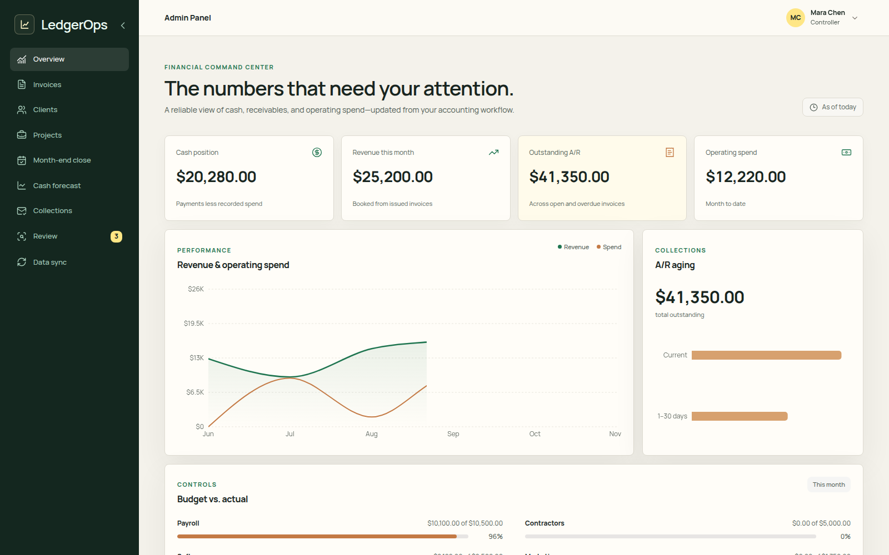
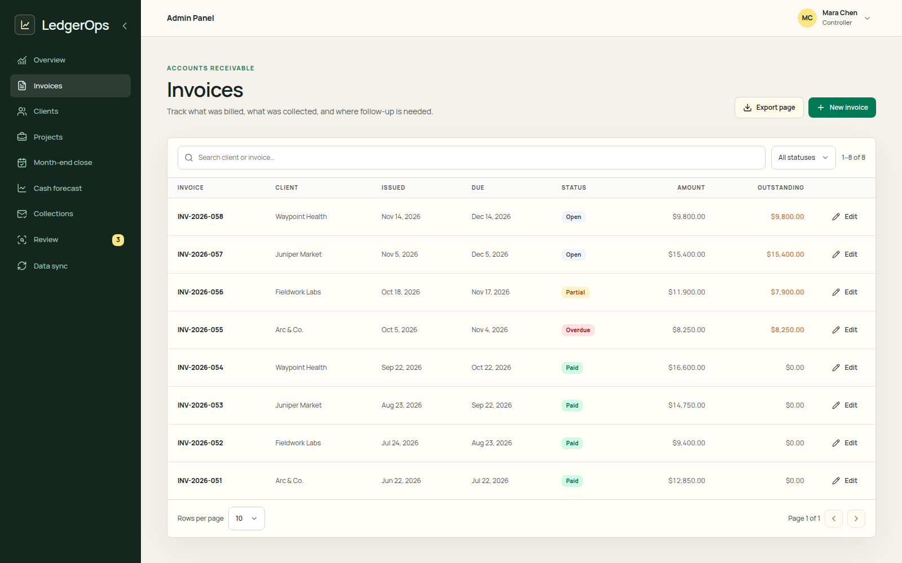
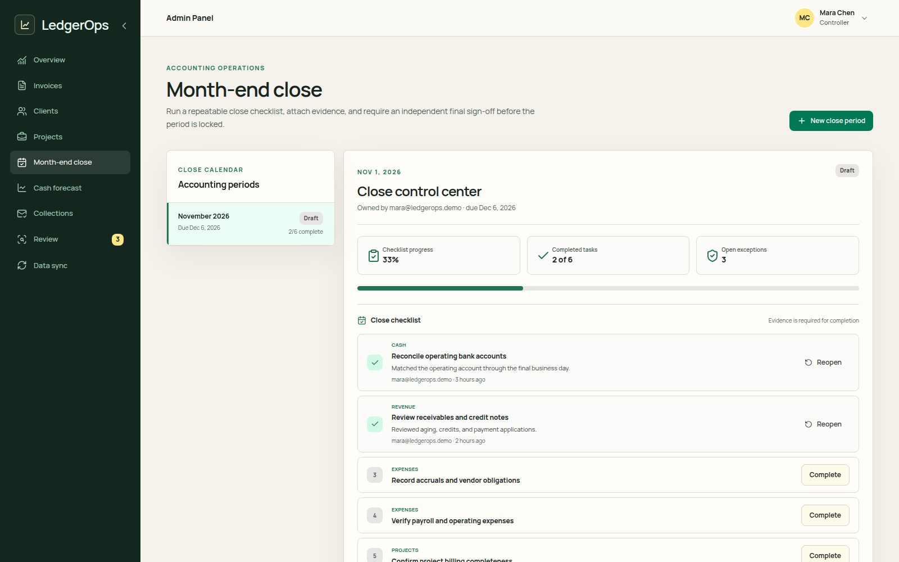
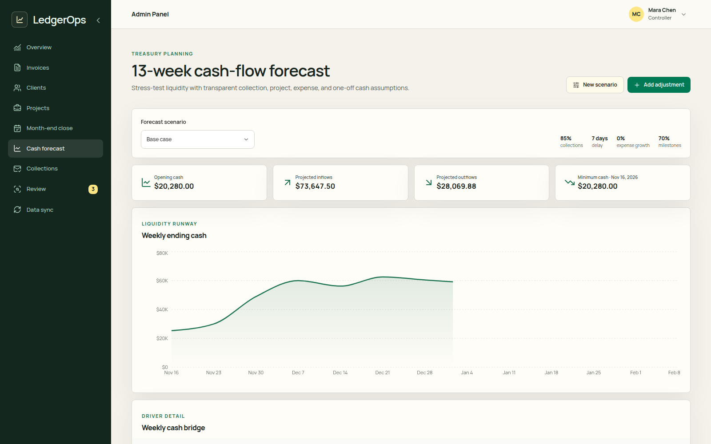

# LedgerOps

LedgerOps is a production-shaped FinOps portfolio project: a Go and PostgreSQL backend, a React/TypeScript client, and a background synchronization worker. It gives accountants one place to inspect cash, receivables, budgets, integration health, and reconciliation exceptions.

   

## Product tour

| Financial command center | Accounts receivable |
| --- | --- |
| [](docs/screenshots/overview.png) | [](docs/screenshots/invoices.png) |
| **Month-end close workspace** | **13-week cash-flow forecast** |
| [](docs/screenshots/month-end-close.png) | [](docs/screenshots/cash-flow-forecast.png) |

## What it demonstrates

- Correct money handling with integer minor units
- Time-ordered UUIDv7 identifiers for public API resources
- Multi-tenant query scoping and database constraints
- Financial summaries, A/R aging, and budget-to-actual reporting
- Client contacts, payment terms, and automated overdue-reminder policies
- Project contracts, controlled change orders, milestone billing, and two-person approvals
- Month-end close periods with evidence-backed checklists, independent sign-off, and immutable locks
- Explainable 13-week cash forecasting with scenarios, invoice and project receipts, operating run-rate, and append-only adjustments
- SMTP reminder delivery with bounded retries and webhook delivery tracking
- PostgreSQL-backed background jobs with idempotency and retry state
- Reconciliation decisions coupled transactionally to audit events
- GORM repositories with explicit SQL for auditable financial reporting
- Feature-based Handler-Service-Repository Go architecture with constructor dependency injection
- Headless UI controls styled with Tailwind CSS
- Zod and React Hook Form validation
- Go unit and HTTP tests, Vitest, Playwright, and CI
- Safe migration and third-party integration runbooks
- QuickBooks OAuth with hashed state, local AES-256-GCM encryption, and production AWS KMS support
- Full and CDC QuickBooks imports for Accounts, Vendors, Customers, Invoices, Payments, Purchases, Bills, Bill Payments, and Credit Memos
- HMAC-verified webhooks, per-entity progress, hourly scheduling, revocation, deletion reconciliation, and transactional outbound writes
- Argon2id passwords, hashed opaque sessions, CSRF protection, and workspace RBAC

## Run it natively

Prerequisites: Go 1.25+, Node.js 22+, and PostgreSQL 18. Start your installed PostgreSQL cluster and create the application database once:

```bash
sudo pg_ctlcluster 18 main start
createdb ledgerops
```

The default connection uses the PostgreSQL Unix socket and current operating-system user through peer authentication. If that role does not exist yet, create it once with `sudo -u postgres createuser --createdb "$USER"`. Override `DATABASE_URL` if your cluster uses a different role, password, port, or database.

Run each process in its own terminal:

```bash
cp .env.example .env
make api
make worker
make web
```

Open <http://localhost:5173>. The API health endpoint is <http://localhost:8080/healthz>. With the local `.env.example` settings, the API applies embedded migrations and idempotent demo seed data on startup. Use the local-only controller demo account:

```text
mara@ledgerops.demo
LedgerOpsDemo!2026
```

To connect a real QuickBooks Online sandbox, add the development credentials and a stable token-encryption key described in [the integration runbook](docs/integration-runbook.md), restart the API and worker, choose **Data sync → Connect QuickBooks**, then run a sandbox sync.

To deliver collection reminders, set `SMTP_HOST`, `SMTP_PORT`, and `EMAIL_FROM_ADDRESS` in `ledgerops/.env` (plus credentials when required), then restart the worker. Set `EMAIL_WEBHOOK_SECRET` on the API and on the trusted email relay that posts normalized delivery events to `POST /api/v1/integrations/email/webhook`. If SMTP is omitted, reminders remain queued and are never reported as sent.

Production startup is fail-closed: set `APP_ENV=production`, HTTPS origins, secure cookies, TLS-enabled non-demo database credentials, and disable demo seeding. See [Security and production hardening](docs/security.md).

## Test it

```bash
make test
npm --prefix frontend exec playwright test
```

Playwright expects the native API, worker, web client, and PostgreSQL service to be running.
If the bundled Playwright browser is unavailable but Chrome is installed locally, run
`PLAYWRIGHT_CHROMIUM_EXECUTABLE_PATH=/usr/bin/google-chrome npm --prefix frontend run test:e2e`.

## Project map

```text
backend/
  cmd/api/             HTTP process
  cmd/worker/          background sync process
  internal/app/        route composition
  internal/database/   connection, embedded migrations, demo seed
  internal/features/   dashboard, close, forecast, projects, invoices, clients, reminders, reconciliation, and sync slices
  internal/financial/  pure financial rules
  internal/jobs/       queue orchestration
  internal/platform/   shared HTTP and application error infrastructure
frontend/
  src/app/             route and application shell composition
  src/features/        feature-owned API, types, schemas, and views
  src/shared/          Headless UI controls, HTTP, and formatting
  e2e/                 Playwright workflows
docs/                  architecture and operational runbooks
```

## Intentional demo boundaries

The app connects to a real QuickBooks sandbox. The first run performs a paginated full import; later runs use per-entity CDC cursors, while verified Intuit webhooks enqueue the same idempotent recovery path. LedgerOps clients, invoices, and invoice payments use a PostgreSQL transactional outbox for outbound writes; accounts-payable entities remain inbound-only by design. Production configuration requires AWS KMS and an Intuit webhook verifier. See [the integration runbook](docs/integration-runbook.md) and [architecture notes](docs/architecture.md).

The included accounts demonstrate `admin`, `controller`, and `reviewer` workspace roles. Controllers can submit project contracts and change orders, while an admin must approve them; requesters cannot approve their own submissions. Approved contract value caps milestone allocation, and milestone invoicing creates a protected invoice and audit trail atomically. Organization access is always derived from the verified server-side session; the browser cannot select a tenant through a trusted header. Demo credentials are for local portfolio use only.

## Engineering notes

- [Architecture and tradeoffs](docs/architecture.md)
- [Safe financial-data migration](docs/migration-runbook.md)
- [QuickBooks incident runbook](docs/integration-runbook.md)
- [Email delivery runbook](docs/email-delivery.md)
- [Authentication and role model](docs/authentication.md)
- [Security and production hardening](docs/security.md)
- [Financial controls and forecasting methodology](docs/financial-controls.md)
- [Railway deployment](docs/railway-deployment.md)
